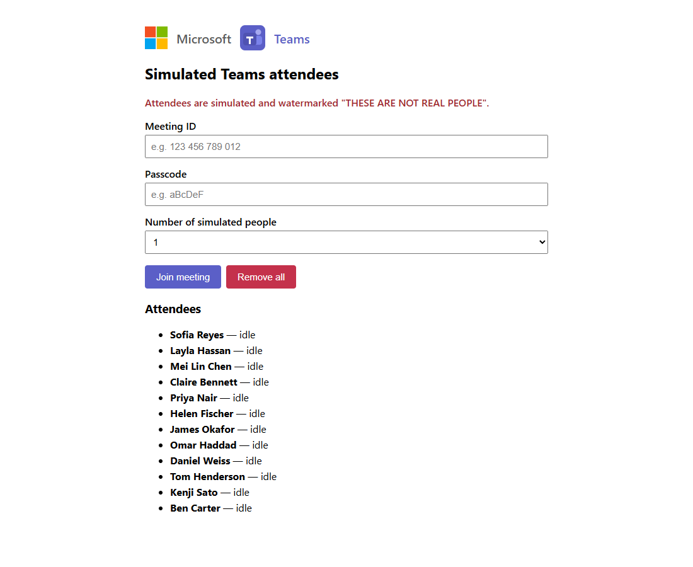
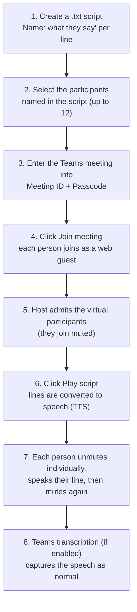
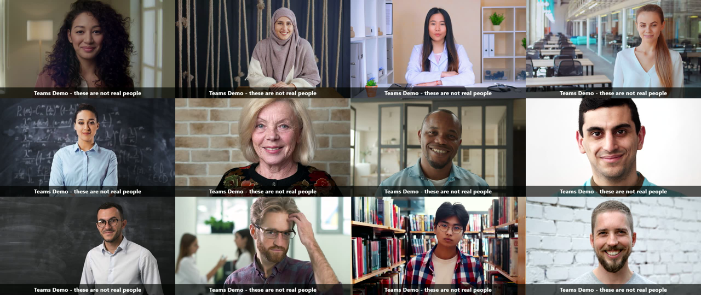

# Teams Simulated People

Fill a Microsoft Teams demo meeting with realistic, **clearly labelled simulated attendees** when real colleagues aren't available. Each simulated person joins the meeting as a web guest, shows a looping front-facing video, joins muted, and then speaks lines from a script you upload - one person at a time - in a natural (non-robotic) voice.



> **Recommended setup:** run this tool on a **separate PC** from the one you host the Teams meeting on. The host PC then hears and records the simulated people exactly as it would real remote participants, with no echo or feedback.

## Download

Get the ready-to-install package, **`TeamsDemoAttendees-v2.zip`**, from the [Releases page](https://github.com/loudy69/Teams-Simulated-People/releases/latest). Extract it on the PC that will run the simulated people, run `Install.cmd`, then `Start.cmd`.

## Demo process flow



| Step | What you do | What happens |
|---|---|---|
| 1 | Create a **.txt** script (see below) with the virtual participants' names | One line or paragraph per speaker: `Name: what they say` |
| 2 | Tick the participants that appear in the script; rename them if you like | Names typed in the UI are carried into the Teams join screen and locked |
| 3 | Enter the Teams **Meeting ID** and **Passcode** | The meeting must allow anonymous (guest) join |
| 4 | Click **Join meeting** | One Edge window per person opens Teams on the web, sets the name, turns the camera on and joins **muted** |
| 5 | The **host admits** the guests from the lobby | Each guest shows as "in meeting" in the UI |
| 6 | Upload the script and click **Play script** | Everyone is muted first; each line is converted to speech (female names get a female voice, male names a male voice) |
| 7 | Watch the meeting | Only the current speaker unmutes, speaks, then goes back on mute before the next person starts. No overlapping speech |
| 8 | Review the transcript/recording | If Teams transcription or recording is on, the speech is captured like any real participant |

### Script format

A plain **.txt** file, one entry per speaker turn:

```
Sofia Reyes: Good morning everyone, thanks for joining.
James Okafor: Thanks Sofia. Let's start with the supplier delays.
Sofia Reyes: Agreed. James, where do we stand?
```

Continuation lines are joined to the previous speaker. Names matching a selected participant use that person; any other name is assigned a participant of the matching gender. See `sample-script.txt`.

## Project description

### Purpose
Demonstrations of Teams features (meeting transcription, recap, Copilot in Teams, recording, moderation and so on) are much more convincing with several people in the call. This project provides up to 12 simulated attendees so a single presenter can demo a realistic multi-person meeting without needing colleagues to attend.

### Capabilities
- **Web UI** (`http://localhost:3000`) to enter the Meeting ID and Passcode and choose any combination of up to 12 people, each with an editable display name.
- **Automatic web join** as an anonymous guest in Microsoft Edge (no "open desktop app" prompt). The display name is typed in, verified and locked so it matches the UI.
- **12 diverse personas**: 6 women and 6 men, multiracial and business-aligned, each with a natural looping front-facing video clip.
- **Watermark** on every video: *"Teams Demo - these are not real people"*, so nobody is misled.
- **Script playback**: upload a TXT script; each line is spoken by the named person.
- **Natural voices**: female names use female voices and male names male voices, via GPT Realtime when an API key is set, otherwise Microsoft Edge neural voices. Gaps between speakers are short so the conversation flows.
- **Mute discipline**: guests join muted; only the current speaker unmutes, and they mute again as soon as they finish. The mute state is verified from the Teams mic button and retried if Teams is slow to update.
- **Recordable audio**: speech is fed into each guest's browser as a virtual microphone, so Teams transmits it like a real participant and it appears in recordings and transcripts.
- **Remove all** button to make everyone leave after the demo.



### How it works
1. Each persona is a separate Edge window driven by [Playwright](https://playwright.dev/).
2. The window opens `https://teams.microsoft.com/v2/?meetingjoin=true#/meet/<id>?p=<passcode>&anon=true`.
3. Chromium's fake-camera flags (`--use-file-for-fake-video-capture`) feed a looping MJPEG clip in as the webcam.
4. An injected script replaces the microphone with a WebAudio `MediaStreamDestination` that is silent except while a line is being played.
5. For each script line the server generates audio (GPT Realtime or Edge TTS), unmutes that guest in Teams, plays the audio into their virtual mic, then mutes them again.
6. Joins are staggered by about 2.5 s to look natural. Guest windows run with `--mute-audio` so they don't play meeting audio back (no echo).

### Architecture

| Path | Purpose |
|---|---|
| `server.js` | Express API, Playwright join flow, virtual mic, mute/unmute control |
| `conversation.js` | Script parsing, gender/voice selection, GPT Realtime and Edge TTS speech |
| `public/index.html` | Web UI |
| `personas.json` | The 12 personas (name, voice) |
| `sample-script.txt` | Example script |
| `scripts/` | Clip conversion and watermark tooling |
| `install.ps1`, `Install.cmd`, `Start.cmd` | Installer and launcher |

## Requirements

- Windows 10/11 with Microsoft Edge
- Node.js LTS (the installer adds it through winget if missing)
- Python (installed by the installer) for the free Edge neural voices
- A Teams meeting that **allows anonymous (guest) join**; the host admits guests from the lobby
- Optional: `OPENAI_API_KEY` (or `REALTIME_API_KEY`) for GPT Realtime voices. Default model `gpt-realtime-2.1` (override with `REALTIME_MODEL`; Azure: set `REALTIME_URL`; disable with `REALTIME=off`). Without a key it falls back to Edge neural voices.

## Install and run

From the release zip: extract, run `Install.cmd`, then `Start.cmd` (opens http://localhost:3000).

From source:

```powershell
git clone https://github.com/loudy69/Teams-Simulated-People
cd Teams-Simulated-People
.\Install.cmd
.\Start.cmd
```

### Video clips

Clips are not stored in the source repo because they are third-party stock footage (the release zip includes them). To build them:

```powershell
winget install Gyan.FFmpeg
npm run import-clips   # place or download source clips into clips\raw
npm run convert        # builds clips\p01-p12.mjpeg with the watermark
```

Source footage came from [Mixkit](https://mixkit.co/license/#videoFree) (free licence). Check the licence before reuse. To change the watermark text, edit `scripts/make-watermark.js`, delete `clips/watermark.png`, and re-run `npm run convert`.

## Troubleshooting

- **Echo:** the host PC's microphone is hearing its own speakers. Host from a separate PC (recommended), or use headphones.
- **Mute/unmute not behaving:** every attempt is logged to `mic-debug.log` in the app folder (which Teams button was found and what state it showed). Send that file when reporting an issue.
- **A guest never joins:** make sure the meeting allows anonymous join and the host admits them from the lobby.

## Responsible use

For demos and testing only. Join only meetings you own or are authorised to use, and keep the watermark on. The attendees are not real people and must not be used to deceive.
Microsoft Teams and Microsoft are trademarks of Microsoft. This is an unofficial demo tool; the join flow relies on the Teams web UI and may need updating when it changes.
