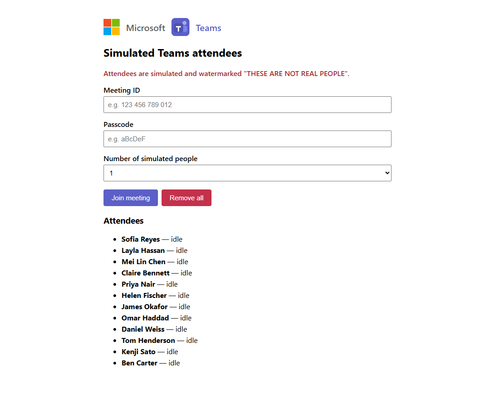
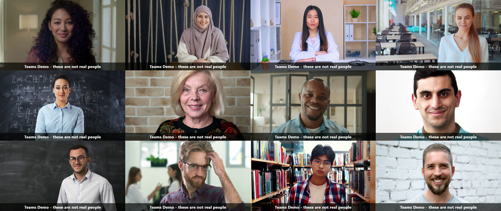

# Teams Simulated People

Fill a Microsoft Teams demo meeting with realistic, **clearly labelled simulated attendees** when real colleagues aren't available.

Enter a Meeting ID and Passcode, choose how many people (1–12), and that many simulated participants join the call as web guests, each showing a looping, front-facing headshot video.



## What it does

- **Web UI** with Meeting ID, Passcode and a 1–12 people-count dropdown.
- **Automatic web join**: opens Teams in the browser (no "open desktop app" prompt) and joins as an anonymous guest.
- **No audio**: each attendee picks "No audio" on the pre-join screen for a smooth, silent join.
- **12 diverse personas**: 6 women and 6 men, multiracial and business-aligned, each with a natural looping video clip.
- **Watermark**: every video carries *"Teams Demo - these are not real people"*, so nobody is misled.
- **Remove all** button to make everyone leave after the demo.



## How it works

1. Each persona is a separate Edge window driven by [Playwright](https://playwright.dev/).
2. The window joins `https://teams.microsoft.com/v2/?meetingjoin=true#/meet/<id>?p=<passcode>&anon=true`.
3. Chromium's fake-camera flags (`--use-file-for-fake-video-capture`) feed a pre-built, looping MJPEG clip in as the webcam.
4. Joins are staggered by about 2.5 s to look natural.

## Requirements

- Windows 10/11 with Microsoft Edge
- Node.js LTS (the installer adds it through winget if missing)
- A Teams meeting that **allows anonymous (guest) join**. The host may need to admit guests from the lobby.

## Install and run

```powershell
git clone https://github.com/loudy69/Teams-Simulated-People
cd Teams-Simulated-People
.\Install.cmd      # installs Node (if needed) and dependencies
.\Start.cmd        # starts the service and opens http://localhost:3000
```

### Video clips

Clips are not stored in this repo, because they are third-party stock footage. To build them:

```powershell
winget install Gyan.FFmpeg
npm run import-clips   # place or download source clips into clips\raw
npm run convert        # builds clips\p01-p12.mjpeg with the watermark
```

Source footage came from [Mixkit](https://mixkit.co/license/#videoFree) (free licence). Check the licence before reuse.
To change the watermark text, edit `scripts/make-watermark.js`, delete `clips/watermark.png`, and re-run `npm run convert`.

## Project layout

| Path | Purpose |
|---|---|
| `server.js` | Express API and Playwright join logic |
| `public/index.html` | Web UI |
| `personas.json` | The 12 personas |
| `scripts/` | Clip conversion and watermark tooling |
| `install.ps1`, `Install.cmd`, `Start.cmd` | Installer and launcher |

## Responsible use

For demos and testing only. Join only meetings you own or are authorised to use, and keep the watermark on. The attendees are not real people and must not be used to deceive.
Microsoft Teams and Microsoft are trademarks of Microsoft. This is an unofficial demo tool; the join flow relies on the Teams web UI and may need updating when it changes.

## Voiced conversations (new)
Pick an **industry** (alphabetical list; Retail and Insurance come with default topic briefs), type a **topic brief**, and once every simulated attendee has been admitted click **Start conversation**.

- An LLM writes one line at a time; each speaker directly responds to the previous one and no two people speak at once (strict turn-taking with natural pauses).
- Each persona has a distinct neural (non-robotic) voice via Microsoft Edge neural TTS (`pip install edge-tts`, needs Python).
- Speech is fed to each attendee's browser as a virtual microphone.
- Set `OPENAI_API_KEY` (or `LLM_API_KEY`, `LLM_ENDPOINT`, `LLM_MODEL`, or `GITHUB_TOKEN`) before starting. `MAX_TURNS` caps the length (default 30).
- Simulated attendees do not listen to real humans; they only respond to each other.

### Local LLM (Foundry Local)
If Foundry Local is installed and a chat model is downloaded (e.g. foundry model download qwen2.5-1.5b), the service auto-detects it and uses it for dialogue - no token cost. Override with FOUNDRY_MODEL, or LLM_PROVIDER=cloud to use OPENAI_API_KEY/LLM_API_KEY instead. Voices use free Edge neural TTS (python + edge-tts, installed by install.ps1).
